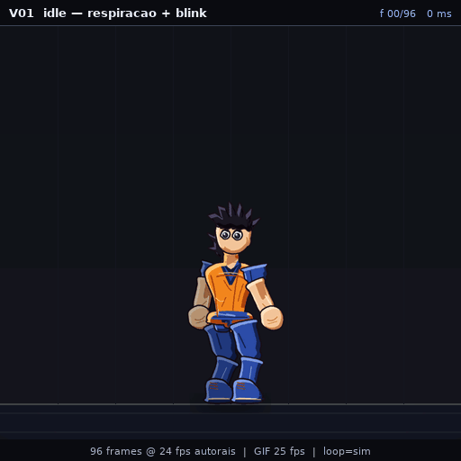
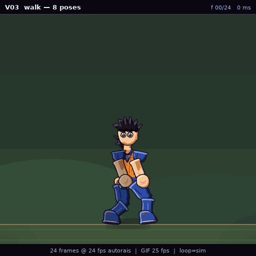
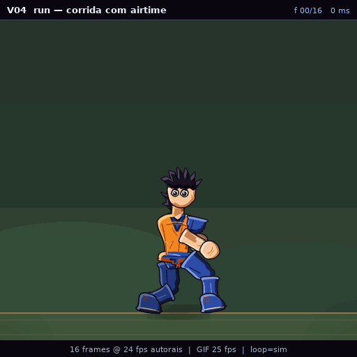
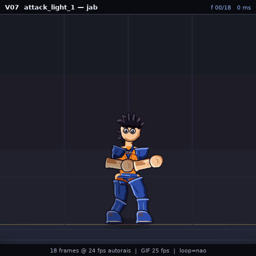
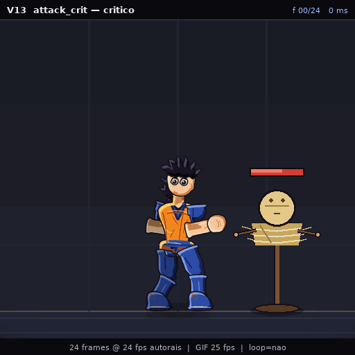
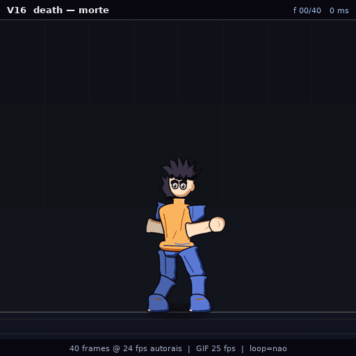
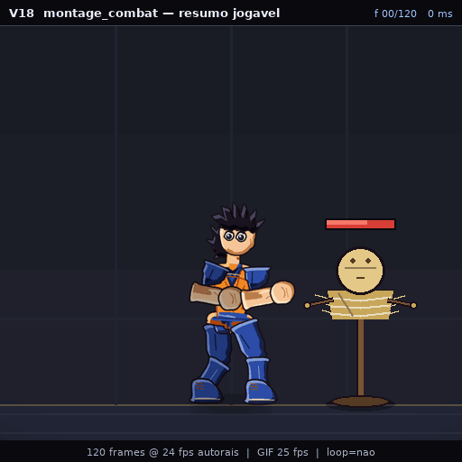

# AURA — asset pack 2D estilo Adventure Quest Worlds (Dragon Ball)

Pack de sprites **modulares, com esqueleto e animação**, para construir um jogo
2D inspirado em AQW. Tudo aqui é gerado por código determinístico a partir de
JSON — não há bitmap desenhado à mão nem arte gerada por IA.

> **Estado:** Fase 2 concluída. Primeiro modelo animado e validado.
> Gate automático G2 ✅ · G3 (rubrica humana) em aberto · **matriz não congelada
> (0.0.0)**.

---

## Ver os GIFs de validação

Os 18 GIFs do Gate G3 estão em
[`dragonball-aqw-asset-pack/exports/characters/DB_CHAR_HERO_GOKU_BASE/previews/`](dragonball-aqw-asset-pack/exports/characters/DB_CHAR_HERO_GOKU_BASE/previews/).

Para revisar tudo de uma vez, com a rubrica de 30 pontos ao lado de cada clipe,
abra [`exports/review.html`](dragonball-aqw-asset-pack/exports/review.html)
(baixe e abra no navegador, ou sirva com `python3 -m http.server`).

### Amostra

| Clipe | GIF |
|---|---|
| **idle** — respiração, blink, loop perfeito |  |
| **walk** — 8 poses, contato de pé e bob |  |
| **run** — fase aérea, inclinação, overlap |  |
| **attack_light_1** — antecipação, snap, hitstop |  |
| **attack_crit** — crítico com dummy, flash e popup |  |
| **death** — queda com peso e trava de chão |  |
| **montage_combat** — resumo jogável |  |

---

## O que já existe

| Camada | Conteúdo |
|---|---|
| **Documentação** | 22 documentos em [`docs/`](dragonball-aqw-asset-pack/docs/) — bíblia visual, spec técnica, rig, padrão de animação, fluidez/GIF, equipamentos, VFX, mapas, UI, naming, integração, gates de QA, catálogo, blueprint do jogo, manual para IA |
| **Padrões** | 10 JSON em [`standards/`](dragonball-aqw-asset-pack/standards/) — esqueleto de 29 ossos, 35 clipes, 29 camadas, paleta, easing, schemas |
| **Renderizador** | [`tools/aura/`](dragonball-aqw-asset-pack/tools/aura/) — 11 módulos: esqueleto, IK, molas, cel shading, composição, VFX, HUD |
| **Primeiro modelo** | `DB_CHAR_HERO_GOKU_BASE` v0.1.0 — 28 peças procedurais, 10 expressões, 23 clipes |
| **Validador** | [`tools/validate_animation.py`](dragonball-aqw-asset-pack/tools/validate_animation.py) — 11 métricas, **23/23 clipes sem falha** |
| **Plano** | [`PLAN.md`](PLAN.md) — decisões (ADR-0001…0006), gates G0–G5, sessões S00–S60 |

### Métricas do portão automático (última execução)

```
23 clipes · 0 falhas
gap de junta 0 px · pivô 0 px · seam de loop 0°/0 px
foot slip ≤ 2 px de desvio · jitter ≤ 3 inversões · canvas sem estouro
ordem de camadas exata · alpha limpo
```

Relatório completo: [`production/qa_reports/DB_CHAR_HERO_GOKU_BASE__anim.json`](dragonball-aqw-asset-pack/production/qa_reports/DB_CHAR_HERO_GOKU_BASE__anim.json)

---

## Como rodar

```bash
cd dragonball-aqw-asset-pack
pip install -r requirements.txt      # Pillow, numpy, opencv-python-headless

python3 tools/cli.py validate        # valida standards e schemas
python3 tools/cli.py anim            # 11 métricas em 23 clipes
python3 tools/cli.py previews        # regenera os 18 GIFs V01–V18
python3 tools/cli.py pack            # manifestos + checksums SHA-256
python3 tools/cli.py check           # tudo acima
```

Não há dependência de GPU, ffmpeg, navegador ou serviço externo. Render medido:
**~57 ms/frame** (512², 24 peças), ~35 s para o conjunto de 18 GIFs.

---

## Estrutura

```
PLAN.md                          plano executivo (pt-BR)
docs/                            specs originais (master-prompt, guides)
dragonball-aqw-asset-pack/
  docs/         00–20 + INDEX    documentação do pack
  standards/    *.json           rig, clipes, camadas, paleta, easing, schemas
  production/   *.json, reports  ledger, continuidade, QA, relatórios de sessão
  tools/aura/                    renderizador
  tools/                         CLI, validador, empacotador
  exports/
    PACK_MANIFEST.json
    checksums.sha256
    review.html                  revisão G3 com rubrica
    characters/DB_CHAR_HERO_GOKU_BASE/
      previews/V01…V18/          18 GIFs
```

---

## Próximos passos

1. **G3** — revisão humana dos 18 GIFs (rubrica ≥ 24/30, nenhum critério < 3).
2. **G4** — congelar matriz: SHA-256 de 8 padrões + Visual Bible, `matrix_version → 1.0.0`.
3. **G5** — expansão: 12 clipes restantes, SSJ, equipamentos, VFX, mapas, UI.

---

## Licença

Fan art não comercial. Dragon Ball é © Bird Studio / Shueisha / Toei Animation.
Detalhes em [`LICENSE_NOTES.md`](dragonball-aqw-asset-pack/LICENSE_NOTES.md).
